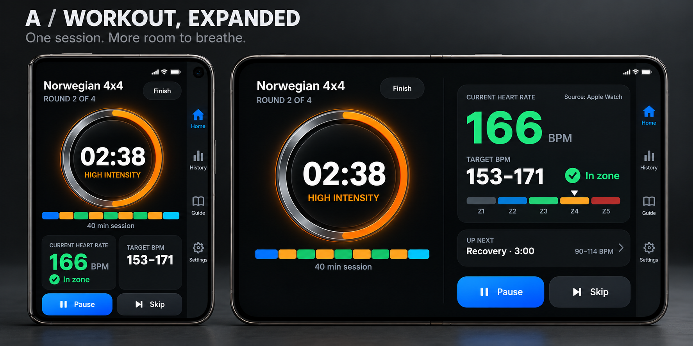
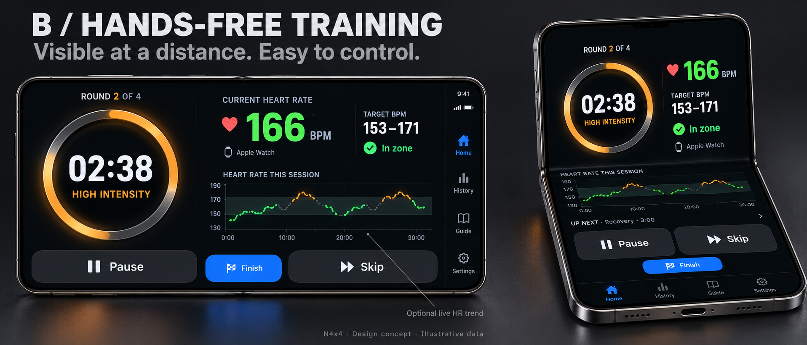
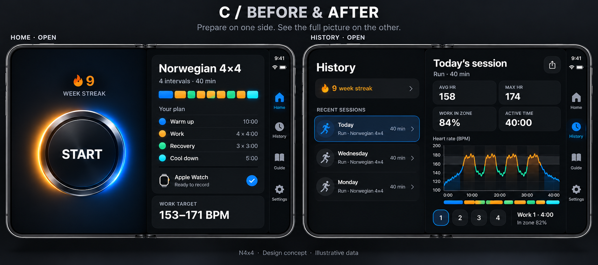

# N4x4 on iPhone Duo — research and design review

Researched 24 October 2026. Status: **concepts for discussion; no app implementation or release changes**.

Recommendation: use **A** for the core workout, add **B's hands-free arrangement**, and expand Home and History as in **C**. Treat B's live chart as a separate feature decision.

## Apple guidance that changes our design

- Use compact and regular width layouts, preserve functionality and navigation state when changing displays, and respect asymmetric margins and safe areas. Side navigation appears on the outer display and landscape inner display; portrait inner display retains horizontal bars. The fold can divide the usable area. [Duo HIG](https://developer.apple.com/design/human-interface-guidelines/designing-for-iphone-duo)
- Building with the **iOS 27.1 SDK / Xcode 27.1** enables the full display and vertical bars. Earlier SDKs use less space. Use size classes and local geometry; avoid screen and device assumptions. Test poses and Split View in Device Hub. SDK adoption is distinct from raising our minimum supported OS. [Preparation guide](https://developer.apple.com/iphone-duo/prepare/), [engineering overview](https://developer.apple.com/videos/play/tech-talks/111461/)
- Native navigation containers supply adaptive bars. Give toolbar actions both a title and symbol; review overflow and action priority. Our custom workout header and Pause/Skip buttons will need deliberate placement; they do not become native toolbar items automatically. [Navigation and bars](https://developer.apple.com/videos/play/tech-talks/111462/)
- **ArrangementView** supports two related content regions. Reserved-region queries identify the fold and camera occlusions. For a propped device, distant-viewing content belongs above the fold and touch controls below. Keep rearrangements restrained. [Adaptive layouts](https://developer.apple.com/videos/play/tech-talks/111463/)
- Use hinge angle for interaction/effects, and arrangement/region APIs for layout. Dual-display accessories have specific availability constraints; the camera accessory is tied to an active camera session. No simultaneous front/back workout-display feature is proposed here. [Displays and scenes](https://developer.apple.com/videos/play/tech-talks/111464/)

## Dimensions: distinguish panel pixels from rendered assets

| Display | Apple panel specification | App Store screenshot sizes |
|---|---|---|
| Closed / outer | 5.4-inch; 1398 × 2034 pixels | 1398 × 2034 portrait; 2034 × 1398 landscape |
| Open / inner | 7.6-inch; 1878 × 2670 pixels | 2007 × 2853 portrait; 2853 × 2007 landscape |

Panel values: [Apple technical specifications](https://www.apple.com/iphone-duo/specs/). Screenshot values: [App Store Connect specifications](https://developer.apple.com/help/app-store-connect/reference/app-information/screenshot-specifications). That page currently states Duo screenshots become required from April 2027 for apps built with the iOS 27.1 SDK or later.

**Do not divide panel pixels by an assumed scale and call the result the layout viewport.** For production and exact design frames, obtain the logical bounds, scale, safe areas and regions from the Duo simulator and Apple design resources. Open landscape is roughly 1.42:1; closed portrait roughly 0.69:1, calculated from published dimensions. The generated boards approximate these shapes; they are not measured templates.

## Three concept boards

### A — Workout, expanded

Closed: timer, current HR, target, status and controls remain visible in a compact stack. Open: timer/timeline and HR/target/controls occupy two related regions, with an Up Next preview.

Main benefit: glanceable workout information using current capabilities. Keep our existing metal-ring asset, phase colors, instant status tint and missing-HR behavior. The blue Pause treatment is a visual option, not a new behavior.

### B — Hands-free training

The same workout rearranges around the fold: timer, live HR and target on the raised region, large Pause and Skip controls on the stable lower region. This is an arrangement of existing content, not a separate workout mode or timer.

**Optional addition:** live HR trend. Recording exists, but the current live recorder is private and the published series is populated at completion. A live chart needs a bounded, read-only presentation snapshot through TimerViewModel, with gaps and source timestamps preserved. Do not bind a chart directly to mutable recorder internals or fabricate missing samples.

Visual correction for implementation: B makes Finish too prominent. Keep it secondary and separate from Pause/Skip, with the existing Finish & Save / Discard / Keep Going flow.

### C — Home and History

Home: familiar START ring and streak beside a readable plan and work target. Preserve the existing VO₂ card when applicable; the simplified board does not depict every state.

History: workout list beside the selected session's chart and interval review. Reuse existing session content. Keep streak/calendar/trend access and editing, sharing, recovery and deletion flows; the board only illustrates the selected-session relationship. Closing should retain the selected session in the compact presentation.

## What the repository already provides

- `ContentView.swift:60`: TimerViewModel is owned above the redesigned shell.
- `HomeWorkoutRedesign.swift:206`: native TabView with Home, History, Guide and Settings.
- `HomeWorkoutRedesign.swift:379` and `:897`: Home/Workout use local geometry and a width-versus-height branch. Useful for sizing, but not sufficient to account for fold regions or distinguish expanded content from short landscape layouts.
- `HomeWorkoutRedesign.swift:1422`: History is a scrolling dashboard and opens details in a sheet.
- `SessionDetailViews.swift:113`: existing SessionStripChart can inform expanded session detail.
- `TimerViewModel.swift:2831`: live HR recorder is private; completedSeries is published.
- Shipping app deployment target is iOS 17.5; both landscape directions are already enabled. Duo-specific APIs need availability gates and an older-OS fallback.

No timer ownership, source arbitration, recording, Watch messaging, Health persistence or workout-save semantics should change merely because the display resizes. Keep birthday Home behavior and measured ring-frame handling intact.

## Proposed implementation sequence, pending design choice

1. Establish the Xcode 27.1 toolchain and capture actual Duo geometry. Export/review Apple's App Resizability skill if available in that toolchain.
2. Implement A with native navigation and safe areas, compact/regular content structure and reserved-region-aware placement. Keep the existing ViewModel instance and workout identity across transitions.
3. Add B's propped arrangement and C's expanded Home. Preserve accessibility scrolling at large text sizes.
4. Implement C's History list/detail navigation with persistent selection. Decide separately whether the optional live chart earns its space.
5. Capture real simulator screenshots and replace concept art in release materials only after validation.

## Acceptance checks for implementation

- Open/close repeatedly while running, paused, at an interval boundary, and at completion: same workout UUID, correct countdown and active duration; no restarted sensors, duplicate exports or duplicate saved entries.
- Rotate both displays; partially fold in book and propped poses; run on either side of Split View. Avoid camera/fold regions, and let native navigation choose its edge.
- Current HR and target remain readable; Pause/Resume stays reachable. Missing/stale HR shows a dash and appropriate copy; instant green/orange/red status remains independent of debounced coaching.
- Preserve selected History entry, draft review edits, tab and modal state when folding. Check Finish, skip confirmation, summary and recovery presentations.
- Exercise largest Dynamic Type, VoiceOver, Reduce Motion, increased contrast, and existing small iPhone layouts.
- Validate readability from actual exercise distance and touch accuracy on physical hardware.

## Deliverables and verification limits

Generated with the built-in **image_gen.imagegen** tool. A and C received one refinement pass; final boards are saved alongside this brief. Exact initial and revision prompts are in [prompts.json](prompts.json).

These are illustrative raster explorations. Native bar rendering, device frames, timeline proportions, chart values and exact safe-area geometry must come from code and the simulator, not image pixels. Sample values are illustrative.

Local tooling checked via explicit DEVELOPER_DIR: **Xcode 26.6 (17F113)**, with iOS/watchOS 26.5 simulators and no Duo simulator listed. Xcode 27.1 / iOS 27.1 is needed for native Duo API compilation and pose validation. No app build or runtime readiness is claimed in this research-only pass.

Follow-up toolchain check: this host is an **M2 MacBook Air with 16 GB RAM,
running macOS 26.7.1**. Apple's [requirements table](https://developer.apple.com/xcode/system-requirements/)
lists macOS 26.6 or later for Xcode 27.1, so no hardware or macOS upgrade is
required. Installing Xcode 27.1 alongside the current version is the preferred
route for interactive Duo simulator review.

A read-only App Store Connect API lookup on 24 October confirmed **Xcode 27.1
(27A9275)** is available in Xcode Cloud. Cloud can compile and run automated
tests with its own toolchain; it does not provide an interactive remote Xcode
desktop. [Cloud workflow documentation](https://developer.apple.com/documentation/xcode/configuring-your-first-xcode-cloud-workflow/)
describes downloadable build artifacts and UI-test screenshots. A separate
development workflow should pin the intended toolchain and avoid the existing
main-branch delivery path. No workflow settings, subscriptions or builds were
changed during this check.

